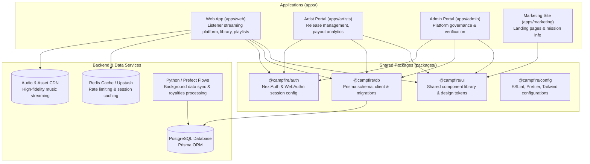

# High-Level Application Architecture

## Ecosystem Overview

Campfire is architected as a **Turborepo monorepo** separating different customer touchpoints (listeners, artists, platform administrators) while sharing core UI design systems, database schemas, and authentication logic.

---

## Architectural Highlights

### 1. Unified Design System (`packages/ui`)
* Component primitives (buttons, modals, input elements, dropdowns, and card layouts) are maintained inside a shared package.
* This ensures that visual brand standards, accessibility patterns, and Tailwind styles remain consistent across both the listener app (`apps/web`) and the creator dashboard (`apps/artists`).

### 2. Isolated Application Domains
* **Listener Web App (`apps/web`)**: Focused on fast streaming audio delivery, catalog discovery, responsive search, personal library management, and smooth playback interactions.
* **Artist Portal (`apps/artists`)**: Tailored for content creators to upload music tracks, manage cover art and album metadata, track stream counts, and monitor payout distributions.
* **Admin Portal (`apps/admin`)**: Internal tool used by foundation staff to verify artist accounts, moderate content, and oversee nonprofit operations.

### 3. Background Data Automation (Python & Prefect)
* While the client applications and primary APIs are built with TypeScript and Next.js, asynchronous tasks (such as periodic ingestion, analytics processing, and metadata synchronization) are orchestrated via **Python Prefect flows** running in the background.
