# Development & Collaboration Workflow

## Team Workflow Overview

As a volunteer software developer at Campfire Music Foundation, I worked within an established startup engineering cadence designed to move fast while maintaining high quality standards.

```mermaid
flowchart LR
    Issue["Task Ticket<br/>(Linear / GitHub)"] --> Branch["Feature Branch<br/>(git checkout -b feature/...)"]
    Branch --> LocalDev["Local Dev & Testing<br/>(pnpm dev, turbo typecheck)"]
    LocalDev --> Hook["Pre-Commit Hooks<br/>(Husky, Prettier, ESLint)"]
    Hook --> PR["Pull Request to 'dev'<br/>(GitHub PR with preview)"]
    PR --> Review["Code Review<br/>(Peer & Senior Engineer)"]
    Review --> CI["CI Pipeline<br/>(Automated Build & Lint)"]
    CI --> Merge["Merge to dev branch & Staging Deploy"]
```

---

## The Engineering Workflow in Detail

### 1. Task Intake & Requirements Definition
* Tasks were tracked and prioritized via issue management tools (Linear / GitHub Issues).
* Before beginning work on features like the **Library Overhaul** or **Liked Songs Shuffle Controls**, we reviewed Figma mockups and user stories to align on expected responsive behavior, audio playback states, and edge cases (e.g., empty playlists, network disconnects during playback).

### 2. Local Development Loop
* **Package Management**: The project standardizes on `pnpm` for fast, disk-efficient package installation.
* **Turbo Dev Pipeline**: Running `pnpm dev` starts the Turborepo dev runner, launching Next.js development servers concurrently with hot-reloading.
* **Type Safety Verification**: Running `pnpm typecheck` leverages Turborepo to validate TypeScript types across all workspace packages simultaneously, catching prop mismatches before committing.

### 3. Git Hygiene & Pre-Commit Automation
* **Branch Naming**: Standardized conventions such as `feature/LibraryOverhaul` or `bugfix/PlayheadBugFix`.
* **Husky & lint-staged**: Pre-commit hooks run automatically upon `git commit` to format code with Prettier and enforce ESLint rules on staged files only, keeping commits clean and consistent.

### 4. Pull Requests & Code Reviews
* Every contribution required a GitHub pull request targeting the `dev` branch.
* PRs included:
  * A clear summary of changes and context.
  * Screenshots or video recordings demonstrating visual changes across both desktop and smaller viewports.
  * Notes on any package or schema updates.
* Changes were reviewed and approved by senior engineers, incorporating feedback on component composition, accessibility, and state management.

### 5. Continuous Integration (CI) & Staging Verification
* Automated GitHub Actions pipelines ran on every PR, executing:
  * Full monorepo dependency installation (`pnpm install --frozen-lockfile`).
  * Monorepo-wide linting and typecheck suites.
  * Production builds across all applications.
* Merged changes automatically deployed to an internal staging environment for QA verification prior to production releases.
